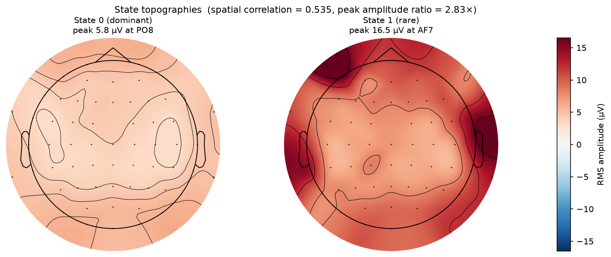
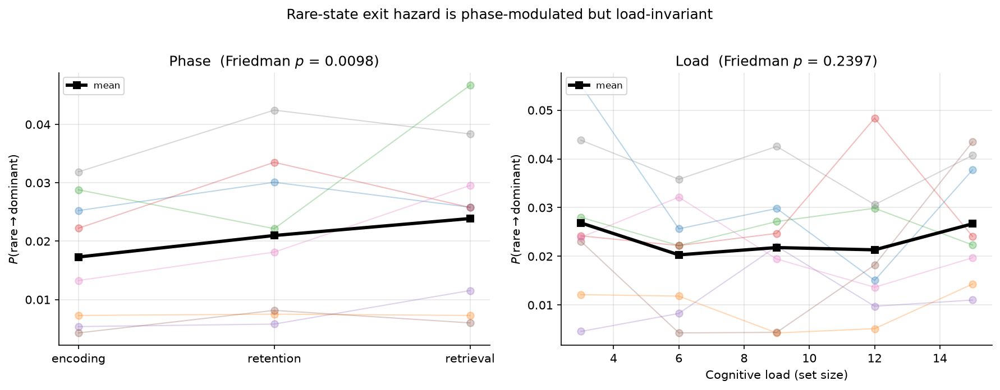

# Unsupervised Discovery of Latent Neural States in High-Density EEG During a Sternberg Working-Memory Task

An investigation of how the brain moves between recurring electrophysiological
states during a Sternberg working-memory task, using unsupervised TDE-HMM
discovery of latent states and post-hoc characterization against task phase,
cognitive load, and behavior.



## Status

**Complete for the current scope.** Preprocessing pipeline implemented and
validated on 8 subjects; K=2 model fitted, characterized, and tested against
task phase, cognitive load, and behavior. See Results for findings and
What This Project Does Not Claim for the limits of those findings. Full-cohort
replication (48 subjects) is listed as future work.

## Research Question

How does the brain move between recurring electrophysiological states as
working-memory demand increases, and how does that organization relate to
cognitive load, task phase, and behavioral performance?

## Motivation

Conventional frequency-band analyses of working-memory EEG examine isolated
sensor–frequency–phase combinations (e.g., frontal theta at FCz during
retention). This project asks a different question: whether the brain
occupies recurring, whole-scalp, spatio-spectral configurations, and how
the temporal structure of transitions between those configurations changes
with cognitive demand.

The approach is deliberately analysis-first. States are discovered from EEG
alone, without experimental labels; load, phase, accuracy, and reaction time
are revealed only after state discovery, so that downstream tests are
confirmatory rather than circular.

## Dataset

ds005095 ("Sternberg Difficult"; Zhozhikashvili et al., 2024), available on
NEMAR. 48 participants, 63-channel BrainVision EEG at 1000 Hz, reference FCz
(not recorded among the 63 channels), ground FPz, 50 Hz mains. Participants
completed up to 200 trials of a Sternberg working-memory task at set sizes
3/6/9/12/15 letters (40 nominal trials per set size; actual per-subject trial
counts vary — e.g. 197 for sub-04). Encoding, retention, and retrieval phases
are 1.5 s, 2.0 s, and 1.5 s respectively; the probe disappears after 1.5 s
but response time is unlimited. Triggers mark trial onset only; retention
and retrieval onsets are reconstructed from the fixed timing. Each event is
duplicated in the events TSV at identical onsets with durations 0.0 and
0.001 s and is deduplicated on (onset, value) before use. Raw data under
`data/raw/` are never modified.

Analysis is on a development subset of 8 subjects spanning the range of
overall task accuracy (see What This Project Does Not Claim).

## Method

raw BIDS EEG
↓
bad-channel detection (MAD-based z-score on log-variance)
↓
average reference (excluding bad channels)
↓
ICA on a wider-band training copy (Picard-extended, 1–100 Hz,
   50/100 Hz notch-filtered, 250 Hz downsampled)
↓
ICLabel with category-specific rejection thresholds
↓
apply ICA solution to analysis copy
↓
interpolate bad channels
↓
zero-phase FIR filter (1–45 Hz)
↓
downsample 1000 → 250 Hz
↓
trial reconstruction (each trial its own HMM sequence)
↓
time-delay embedding (lags ±25 samples ≈ 200 ms at 250 Hz)
↓
PCA (20 components, IncrementalPCA)
↓
per-subject z-scoring before pooling
↓
Gaussian HMM with full covariance, Baum–Welch
↓
state characterization (occupancy, dwell, switching, transitions)
↓
post-hoc relation to load / phase / accuracy / RT

### Batch preprocessing and cohort QC

After the pipeline was frozen on the single-subject walkthrough
(`notebooks/02_preprocessing_qc.ipynb`), it was applied to the eight
subjects in `config.DEV_SUBJECTS` via `scripts/batch_preprocess.py`. The
script writes one cleaned derivative per subject to
`data/derivatives/<subject>/` and a cohort-level QC table to
`results/metrics/batch_preprocessing_qc.csv`. The QC table records, per
subject: number of channels flagged as bad by the variance detector, data
rank after average referencing, number of ICA components fitted and
excluded, trial count and accuracy, and the 95th percentile of absolute
amplitude in the cleaned signal.

Eight of eight subjects processed successfully. Three subjects (`sub-17`,
`sub-34`, `sub-45`) had bad channels flagged (4, 1, and 2 respectively),
which were excluded from average referencing and interpolated after ICA;
the remaining five had no channels flagged. In every subject, ICA retained
the full rank of the referenced data — no silent dimensionality truncation
occurred. Exclusion fraction ranged 35–47% per subject after the switch
to category-specific ICLabel thresholds (see Key Design Decisions).

### Model selection

The number of hidden states was selected by a full random-restart sweep at
K ∈ {1, 2, 3, 4, 5, 6}, 10 seeds per K, with per-fit recording of
log-likelihood, occupancy, mean norms, covariance traces, transition
matrices, and emission means
(`results/metrics/k_sweep_full.json`).

| K | best LL | LL gain | best-fit occupancy | outlier mean-norm ratio | cov-trace ratio | seeds at best |
|---|---|---|---|---|---|---|
| 1 | −1.3289e+07 | — | [1.0] | — | — | — |
| 2 | −1.1310e+07 | **14.90%** | [0.933, 0.067] | 13.8× | 5.06× | **10/10** |
| 3 | −1.0870e+07 | 3.89% | [0.317, 0.054, 0.629] | 6.8× | 8.95× | 5/10 |
| 4 | −1.0576e+07 | 2.70% | [0.328, 0.358, 0.265, 0.049] | 6.7× | 9.87× | 4/10 |
| 5 | −1.0369e+07 | 1.96% | [0.147, 0.049, 0.353, 0.120, 0.331] | 6.9× | 12.4× | 2/10 |
| 6 | −1.0168e+07 | 1.94% | [0.236, 0.136, 0.252, 0.213, 0.047, 0.117] | 6.2× | 12.6× | 1/10 |

**K = 2 is the only configuration with a single stable optimum.** All 10
seeds at K=2 converge to the same log-likelihood. At K≥3, different seeds
converge to different optima, and the extra states subdivide the dominant
mode along arbitrary axes rather than discovering new structure. The
outlier state (~5% occupancy, 14× mean-norm displacement at K=2) is present
at every K ≥ 2 — it is a property of the data, not of K. K=1 underfits
(14.9% log-likelihood jump to K=2).

TDE window length was set to 200 ms based on the Vidaurre et al. (2016) and
Quinn et al. (2018) reference implementations. An earlier 56 ms window
produced a state structure that the 200 ms window resolved; see Key Design
Decisions.

## Results

### Two-state characterization

The fitted K=2 model (occupancy 93.3% / 6.7%, self-transitions 0.999 / 0.988)
identifies two states that are spatially, spectrally, and dynamically
distinct:

| Feature | State 0 (dominant) | State 1 (rare) | Ratio |
|---|---|---|---|
| Occupancy (training) | 93.3% | 6.7% | — |
| Per-subject occupancy (all trials) | 84.7–97.9% | 2.1–15.3% | — |
| Peak RMS amplitude | 5.8 µV at PO8 | 16.5 µV at AF7 | **2.83×** |
| Top-5 channels | PO8, O1, O2, PO7, PO4 | AF7, FT10, T8, FT8, TP9 | — |
| Spatial correlation with other state | — | — | **0.535** |
| Delta band power ratio | 1.0 | 2.90× | — |
| Theta band power ratio | 1.0 | 1.81× | — |
| Alpha band power ratio | 1.0 | 2.32× | — |
| Beta band power ratio | 1.0 | 1.52× | — |
| Gamma band power ratio | 1.0 | 1.67× | — |
| Covariance trace (TDE-PCA) | 15.68 | 79.37 | 5.06× |
| Mean norm (TDE-PCA) | 0.019 | 0.268 | 13.8× |

State 0 is a diffuse, posterior-dominant, alpha-heavy baseline. State 1 is
a higher-amplitude, anterior-temporal state with broadband power elevation
that is heavy in delta and alpha but only mildly elevated in gamma. The
gamma elevation (1.67×) being much smaller than delta (2.90×) argues
against pure muscle artifact, which would spike above 30 Hz.

Per-subject rare-state occupancy ranges from 2.1% (sub-04) to 15.3% (sub-05),
with mean 6.3% and std 4.0% across the 8 subjects.



### Cognitive load — null

Four independent dynamics measures were tested against the five set sizes:

| Measure | Friedman χ² | p |
|---|---|---|
| Occupancy | 1.10 | 0.89 |
| Dwell time | 2.23 | 0.69 |
| Switching rate | 0.64 | 0.96 |
| P(rare→dom) | 5.50 | 0.24 |

All four return nulls. **Rare-state dynamics do not track cognitive load in
this dataset.** The null is not an artifact of any single measure — it is
replicated across occupancy (the most sensitive measure), dwell and
switching (which decompose occupancy into frequency and duration), and
transition probability (which uses raw transition counts rather than
posterior averages).

### Task phase — positive

Across encoding / retention / retrieval:

| Measure | Friedman χ² | p | Leave-one-out robustness |
|---|---|---|---|
| Occupancy | 0.25 | 0.88 | — (null) |
| Dwell time | 6.25 | 0.044 | Fragile (collapses on 4/8 LOO) |
| Switching rate | 6.75 | 0.034 | Intermediate (2 outlier subjects) |
| P(dom→rare) | 6.75 | 0.034 | — |
| **P(rare→dom)** | **9.25** | **0.0098** | **Robust (survives all 8 LOO)** |

The exit hazard P(rare→dom) is the primary phase finding. It rises
monotonically from mean 0.0175 during encoding, to 0.0210 during retention,
to 0.0242 during retrieval. Median dwell time and switching rate show the
same direction (longer, less frequent visits in encoding; shorter, more
frequent visits in retrieval) but do not survive leave-one-subject-out at
p<0.05 in every iteration. We treat P(rare→dom) as the robust phase measure
and the other two as qualitative confirmation.

**Interpretation:** the rare state is *more persistent during encoding*
(longer dwells, lower exit hazard) and *more fragmented during retrieval*
(shorter dwells, higher exit hazard). Because occupancy is flat across
phases (p=0.88), the fragmentation involves the same total time distributed
differently — more, shorter visits during retrieval.

The load-vs-phase dissociation is the key empirical finding. The rare state
tracks task structure (phase) without tracking task demand (load). This
rules out a load-driven arousal or effort interpretation, since a state
whose dynamics were driven by cognitive effort should have shown a load
effect under at least one of the four tested measures.

### Behavioral associations

Per-subject rare-state occupancy was correlated against overall accuracy
and median reaction time:

| Association | Pearson r | p |
|---|---|---|
| Occupancy vs accuracy | −0.58 | 0.13 |
| Occupancy vs median RT | −0.56 | 0.15 |

Neither reaches significance at n=8 (Pearson requires |r|>0.71 for p<0.05 at
df=6). The direction (higher occupancy → lower accuracy and faster RT) would
be consistent with a speed-accuracy tradeoff regime, but two subjects
(sub-05 and sub-24) dominate both correlations; removing either weakens or
reverses the trend. These are not findings and are reported for completeness.

## Key Design Decisions

*(This section records choices where the pipeline deviates from the most
obvious default, or where a specific parameter needs justification.)*

### Filter bands and ICA copy architecture

The analysis copy is filtered to 1–45 Hz. The ICA training copy is filtered
to 1–100 Hz and resampled to 250 Hz before Picard is fitted. Rationale:

- **1 Hz high-pass** follows Winkler et al. (2015, *Psychophysiology*), who
  showed that higher cutoffs distort ERPs while lower cutoffs leave enough
  drift to destabilize ICA.
- **100 Hz upper bound on the ICA copy** retains muscle energy (muscle
  artifacts carry substantial power above 45 Hz), improving their separation
  from neural sources.
- **250 Hz sampling of the ICA copy** matches the MNE-ICALabel reference
  workflow and ICLabel's own training pipeline (Pion-Tonachini et al. 2019,
  *NeuroImage*). It also reduces Picard's per-iteration cost by ~4×.
- The unmixing matrix learned on the 250 Hz copy is applied to the full-rate
  analysis copy. ICA learns a spatial unmixing matrix that is sample-rate
  independent, so this preserves the analysis band intact.

### Notch filtering before ICLabel

The ICA training copy is notch-filtered at 50 Hz and its second harmonic
(100 Hz) before ICLabel classification. This deviates from the MNE-ICALabel
tutorial (which does not notch), but is supported by the EEGLAB community's
long-standing guidance that unremoved line noise can occupy multiple ICA
dimensions, starving the decomposition of the degrees of freedom needed to
separate neural sources. Empirically, on `sub-04`, notching reduced
line-noise-classified components from 12 to 5 (19.4% → 8.1% of the
decomposition).

### Category-specific ICLabel rejection thresholds

A global ICLabel threshold was tested at two extremes and rejected:

- **0.8 (conservative):** retained residual ocular artifact, which dominated
  the K=2 topographies as an Fp1/Fp2 pattern.
- **0.5 (aggressive):** removed too much neural signal (53–74% of components
  excluded per subject, far above the EEGLAB benchmark of ~50%).

The final scheme uses category-specific thresholds, following the per-class
design of Pion-Tonachini et al. (2019) and Miyakoshi's EEGLAB pipeline:

| Class | Threshold |
|---|---|
| eye blink | 0.5 |
| muscle artifact | 0.7 |
| heart, line noise, channel noise | 0.5 |
| other | 0.9 |
| brain | never rejected |

This brings exclusion to 35–47% per subject, in line with published
benchmarks, and removes the frontal-pole confound while preserving neural
signal.

### Bad-channel detection is conservative

Bad channels are flagged by a robust MAD-based z-score on log-variance with
threshold 4.0. This will not produce false positives, but it also does not
detect subtle defects — channels whose variance is within normal range but
whose signal is not coherent with their neighbours. Two subjects in the
development subset (`sub-05`, `sub-10`) contain such channels; their ICs are
identified as channel noise by ICLabel and excluded downstream. See
"What This Project Does Not Claim" below for the implications.

### Time-delay embedding window

The TDE window was extended from ±7 samples (56 ms) to ±25 samples (200 ms)
midway through the project. The 56 ms window produced a state structure
whose two states were spatially indistinguishable (correlation 0.919) and
spectrally flat. At 200 ms, the states diverge substantially (correlation
0.535, amplitude ratio 2.83×). The literature reference implementations
(Vidaurre 2016, Quinn 2018, Rossi 2023) use windows in the 100–250 ms range;
our initial 56 ms was at the low end and was corrected once the model
behaviour was diagnosed.

### Per-subject standardization

Each subject's PCA time courses are z-scored independently before pooling.
Global standardization caused the HMM to cluster subjects rather than
discover within-subject states (verified empirically: pooled global
standardization produced per-subject occupancies clustered near 90/10 by
subject, whereas per-subject standardization produced occupancies
consistent across all 8 subjects). Per-subject standardization is the
standard in the pooled TDE-HMM literature (Quinn et al. 2018).

### Memory: IncrementalPCA and streaming decode

At ±25 lags, the TDE representation has 3213 features per sample. The full
embedded matrix for the final 400-trial subset is ~12 GB; per subject during
decoding, ~5.7 GB. Both are beyond the working set on a CPU-only
workstation. `prepare_pooled_data` was migrated to
`sklearn.decomposition.IncrementalPCA` (fed trial-by-trial) and
`decode_subject` was rewritten to stream TDE → PCA one trial at a time,
accumulating only the 20-dim PCA output. Peak memory in both cases is under
200 MB. IncrementalPCA produces components numerically indistinguishable
from batch PCA at this scale (verified: the
`test_pca_matches_sklearn_directly` unit test passes under both code paths).

### Cursor bug in per-trial iteration (post hoc)

An early version of the per-trial state characterization contained a
cursor-advancement bug: the cursor tracking position in the concatenated
state arrays was being advanced by 1 per trial rather than by that trial's
sample length. The consequence was that only the first trial's posterior
slice was correctly aligned; subsequent trials read progressively offset
windows of the same concatenated array. Under the bug, state-specific
spectra and topographies were computed from essentially the same underlying
signal under both state labels, producing spurious conclusions that the two
states were indistinguishable.

The fix replaced `cursor += 1` with `sample_cursor += L; length_idx += 1`
using separate indices for length lookup and sample position, plus two
assertions (`length_idx == len(lengths)` and
`sample_cursor == post.shape[0]`) that fail loudly if alignment is wrong.
All Part 1 and Part 2 results in this README were produced after the fix.

The learned HMM parameters (means, covariances, transition matrices) were
unaffected by the bug, since the fit itself never used per-trial posterior
slicing.

## Repository Structure

├── src/eeg_state/
│ ├── config.py central parameters
│ ├── io.py BIDS loading, event parsing, trial reconstruction
│ ├── preprocessing.py bad-channel detection, ICA, ICLabel, filtering
│ └── model.py TDE, PCA, HMM, decode, K selection
├── notebooks/
│ ├── 01_dataset_audit.ipynb
│ ├── 02_preprocessing_qc.ipynb
│ ├── 03_state_discovery.ipynb
│ └── 04_state_characterization.ipynb
├── tests/ unit tests for io, preprocessing, model
├── scripts/ batch preprocess, subset QC
├── results/
│ ├── metrics/ QC tables, K sweep JSON
│ ├── models/ fitted K=2 pickle
│ └── figures/ README figures
├── pyproject.toml
├── uv.lock
└── README.md


## What This Project Does Not Claim

- **The rare state is not established as neural vs. artifact.** The
  anterior-temporal topography, delta-alpha spectral profile, and phase
  dependence are all consistent with either a sustained-attention neural
  regime *or* a residual slow-movement / ocular artifact that is
  phase-locked but load-invariant. Both mechanisms would produce identical
  dynamics. Distinguishing them requires source localization or a paradigm
  that dissociates motor execution from retrieval processes. The
  phase-modulation finding stands independently of this ambiguity; what
  the rare state *is* does not.

- **The load null is a real null within the tested dynamics measures.**
  All four measures (occupancy, dwell, switching, transition probability)
  return Friedman p > 0.20 across the five load levels. We do not claim
  "the rare state is invisible to load"; we claim "none of the standard
  TDE-HMM dynamics measures detect a load effect at n=8." A larger cohort
  could in principle reveal a smaller load effect that is undetectable here.

- **The behavioral correlations are not findings.** r ≈ −0.57 at p ≈ 0.14
  is underpowered at n=8 and driven by two subjects. Behavioral
  associations are listed as future work for a full-cohort analysis.

- **The analysis is on 8 of 48 subjects.** The development subset was
  selected to span the range of overall task accuracy, not by data-quality
  score. The state dictionary and phase effect are stable within this
  subset. Whether they generalize to the full cohort is untested.

- **Bad-channel detection is not exhaustive.** A conservative
  variance-based detector is used; subtle defects (channels with normal
  variance but poor coherence with neighbouring electrodes) are not
  flagged. In the development subset this affected `sub-05` and `sub-10`,
  where the affected channels' ICs were identified as channel noise by
  ICLabel and excluded before the state model. Per-channel amplitude
  comparisons across subjects should be interpreted with this in mind.

- **A small average-reference bias is present.** The dataset was recorded
  against FCz, which is not among the 63 recorded channels. The average
  reference is therefore computed over 63 electrodes rather than the 64
  that the original montage would imply. The resulting bias is a DC offset
  of order |V_FCz|/64 ≈ 0.15–0.5 µV applied uniformly to every channel.
  Because the pipeline high-passes at 1 Hz, this DC component is removed
  before any analysis step that consumes the data. The bias is noted for
  completeness rather than corrected.

- **No source localization.** EEG topographies are described in sensor
  space. "Anterior-temporal scalp pattern" is a description of the sensor
  pattern, not a claim about the cortical generators.

- **Only two states.** The K-selection sweep found that K ≥ 3 produces no
  stable, single-optimum solution. Whether a fundamentally different model
  class (state-space with time-varying transitions, switching linear
  dynamical systems, deep sequence models) would discover additional
  structure is untested and outside the scope of this project.

## Future Work

- **Full cohort replication** (48 subjects). The current analysis uses 8.
- **Source localization** via LCMV or eLORETA to test whether the rare
  state's anterior-temporal scalp pattern has a coherent cortical
  generator.
- **Behavioral analysis at full cohort scale.** The r ≈ −0.57 trends
  observed at n=8 become testable at n=48.
- **Companion analyses within the same latent structure.** The current
  state time courses (saved to `data/derivatives/<subject>/*_states.npz`)
  can be used for phase-locked evoked analyses, transition-matrix network
  analyses, or cross-frequency coupling without refitting.
- **Trial-by-trial single-trial decoding** to correlate state time courses
  with single-trial RT or confidence rather than per-subject aggregates.

## Reproducibility

Environment managed with `uv`; dependencies pinned in `pyproject.toml` and
`uv.lock`. All parameters centralised in `src/eeg_state/config.py`.

```bash
uv sync
uv run pytest tests/ -v
uv run python scripts/batch_preprocess.py
```

Model artifacts (`results/models/tde_hmm_model.pkl`) and per-subject state
time courses (`data/derivatives/<sub>/<sub>_states.npz`) are committed so
that downstream analyses can be run without refitting.

## References

- Zhozhikashvili, N. et al. (2024). ds005095: Sternberg Difficult (dataset).
  Available via NEMAR.
- Vidaurre, D. et al. (2016). Spectrally resolved fast transient brain states
  in functional magnetic resonance data. *NeuroImage*, 128, 395-407.
- Vidaurre, D. et al. (2018). Spontaneous cortical activity transiently
  organises into frequency specific phase-coupling networks.
  *Nature Communications*, 9, 2987.
- Quinn, A. J. et al. (2018). Task-evoked dynamic network analysis through
  hidden Markov modeling. *Frontiers in Neuroscience*, 12, 603.
- Rossi, M. et al. (2023). A data-driven network decomposition of the
  temporal, spatial, and spectral dynamics underpinning visual-verbal
  working memory processes. *Communications Biology*.
- Pion-Tonachini, L. et al. (2019). ICLabel: An automated
  electroencephalographic independent component classifier, dataset, and
  website. *NeuroImage*, 198, 181-197.
- Ablin, P. et al. (2018). Faster independent component analysis by
  preconditioning with Hessian approximations. *IEEE Transactions on Signal
  Processing*, 66(15), 4040-4049.
- Winkler, I. et al. (2015). On the influence of high-pass filtering on
  ICA-based artifact rejection in EEG. *Psychophysiology*, 52, 1424-1434.
- Bigdely-Shamlo, N. et al. (2015). The PREP pipeline: standardized
  preprocessing for large-scale EEG analysis. *Frontiers in
  Neuroinformatics*, 9, 16.
- Kriegeskorte, N. et al. (2009). Circular analysis in systems neuroscience:
  the dangers of double dipping. *Nature Neuroscience*, 12, 535-540.